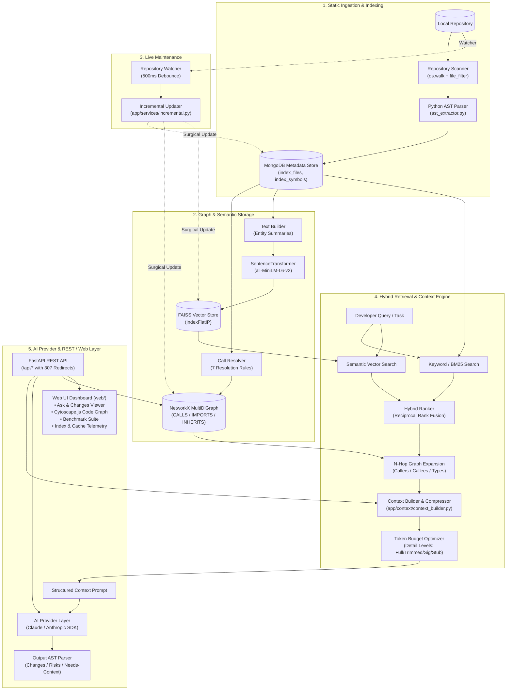

# Code Context Engine

The **Code Context Engine** reduces the tokens an AI coding agent needs on large repositories by combining a structural code graph with semantic retrieval. Instead of dumping entire directories or broad file sets into LLM prompt contexts, it analyzes dependencies and extracts precise, targeted context windows. This approach preserves essential semantic connections while cutting token overhead and latency.

---

## 10-Step Development Roadmap

- [x] **Step 1: Project setup + repository scanner**
- [x] **Step 2: Python AST parser**
- [x] **Step 3: Metadata store**
- [x] **Step 4: Code graph**
- [x] **Step 5: Semantic embeddings**
- [x] **Step 6: Hybrid retrieval**
- [x] **Step 7: Context builder + token budget**
- [x] **Step 8: AI provider layer + FastAPI**
- [x] **Step 9: Token measurement + before/after comparison**
- [x] **Step 10: Web UI + graph visualization + incremental indexing**

---

## Storage (MongoDB)

Everything persistent lives in one MongoDB database: the code index, call graph, embeddings, workspaces, conversations, messages, attachments, and edit history. Uploaded working copies of source files stay on disk under `data/workspaces/`.

```bash
# .env
MONGODB_URI=mongodb://localhost:27017
MONGODB_DB=code_context_engine   # optional, this is the default
```

Without `MONGODB_URI` the server and the test suite use an in-memory MongoDB substitute (`mongomock`). Data is then lost when the process exits, and CLI commands that keep state between runs (`index`, `embed`, `graph-build`, ...) refuse to run. The test suite always uses the in-memory substitute.

---

## How a request uses the code graph

`POST /api/retrieve`, `POST /api/ask`, and chat turns return a `trace` that explains the request:

- **signals**: which of semantic, keyword, and graph retrieval ran, were skipped, or failed, and every hit each produced
- **graph_edges**: the `CALLS` edges walked from the target (callees and callers) and whether each added or boosted a candidate
- **operations**: ordered steps (intent detection, target identification, semantic and keyword search, AST and graph expansion, context packing, token accounting, LLM call) with timings
- **selection**: what was packed, at which detail level (full, trimmed, signature, stub, reference), its tokens versus the original source, and what was pruned and why
- **savings**: tokens in the prompt versus pasting every indexed file and versus pasting each contributing file whole, as measured with the same tokenizer. If tiktoken's vocabulary cannot be downloaded, counts fall back to ~4 characters per token and are flagged as estimates.

The chat UI shows this as a one-line summary under each answer and a full panel on the right.

---

## Quickstart & Setup

### 1. Create Virtual Environment

On Windows (PowerShell):
```powershell
python -m venv .venv
.\.venv\Scripts\Activate.ps1
```

On Linux / macOS:
```bash
python3 -m venv .venv
source .venv/bin/activate
```

### 2. Install Dependencies

```bash
pip install -r requirements.txt
```

### 3. Run Tests

```bash
pytest -v
```

### 4. Run CLI Commands

#### Scan Repository (`scan`):
```bash
# Human-readable summary
python -m app.main scan .

# Dump full ScanResult as JSON
python -m app.main scan . --json

# Custom file extensions and maximum file size
python -m app.main scan . --ext .py .sql --max-size 2000000
```

#### Parse Entire Repository (`parse`):
```bash
# Scan + parse whole repo, showing ParseSummary, errors, and top callables
python -m app.main parse .

# Dump full parsed repository output as JSON
python -m app.main parse . --json
```

#### Parse Single File Structure Tree (`parse-file`):
```bash
# Pretty-print file structure as an ASCII tree
python -m app.main parse-file app/scanner/repository_scanner.py

# Dump single file ParsedFile model as JSON
python -m app.main parse-file app/scanner/repository_scanner.py --json
```

#### Index Repository (`index`):
```bash
# Incremental index (only parses added or modified files, deletes removed files)
python -m app.main index .

# Force re-indexing from scratch
python -m app.main index . --force

# Dump IndexReport as JSON
python -m app.main index . --json
```

#### View Store Statistics (`stats`):
```bash
# Instant statistics query from the MongoDB metadata store without re-parsing
python -m app.main stats .

# Dump StoreStats as JSON
python -m app.main stats . --json
```

#### Find Symbols (`find`):
```bash
# Search for functions, methods, or classes by name
python -m app.main find . scan_repository

# Dump search results as JSON
python -m app.main find . scan_repository --json
```

#### Show Symbol Details & Source (`show`):
```bash
# Display full signature, arguments, docstring, calls, and source code
python -m app.main show . app.scanner.repository_scanner.scan_repository

# Dump symbol details as JSON
python -m app.main show . app.scanner.repository_scanner.scan_repository --json
```

#### Build Code Graph (`graph-build`):
```bash
# Build NetworkX MultiDiGraph from the index, resolve calls, and persist it in MongoDB
python -m app.main graph-build .

# Include low-confidence ambiguous call targets
python -m app.main graph-build . --include-ambiguous

# Dump GraphBuildReport as JSON
python -m app.main graph-build . --json
```

#### View Graph Statistics (`graph-stats`):
```bash
# Display total nodes, edges, node type breakdown, and relationship edge counts
python -m app.main graph-stats .

# Dump statistics as JSON
python -m app.main graph-stats . --json
```

#### Query Callees (`callees`):
```bash
# Direct callees (depth=1)
python -m app.main callees . get_user

# Transitive callees up to N depth
python -m app.main callees . login_user --depth 2
```

#### Query Callers (`callers`):
```bash
# Functions and methods that call target symbol
python -m app.main callers . verify_password

# Transitive callers up to N depth
python -m app.main callers . hash_password --depth 2
```

#### Graph Neighborhood (`neighbors`):
```bash
# Direction-agnostic N-hop neighborhood subgraph around symbol
python -m app.main neighbors . Session --hops 2
```

#### Shortest Dependency Path (`path`):
```bash
# Shortest path over CALLS edges between two functions
python -m app.main path . login_user hash_password
```

#### File Dependencies (`file-deps`):
```bash
# Display imports, imported_by, depends_on, and depended_on_by for a file
python -m app.main file-deps . app/main.py
```

#### Build Semantic Embeddings (`embed`):
```bash
# Build or incrementally update embeddings from MetadataStore into FAISS index
python -m app.main embed .

# Force complete rebuild from scratch
python -m app.main embed . --force

# Custom model override
python -m app.main embed . --model sentence-transformers/all-MiniLM-L6-v2

# Output EmbeddingReport as JSON
python -m app.main embed . --json
```

#### View Vector Store Statistics (`embed-stats`):
```bash
# Display manifest, item count, and per-kind counts without loading the model
python -m app.main embed-stats .

# Dump vector store stats as JSON
python -m app.main embed-stats . --json
```

#### Semantic Natural Language Search (`semantic`):
```bash
# Search repository entities using semantic natural language queries
python -m app.main semantic . "improve password performance"

# Top-K results limit
python -m app.main semantic . "send a notification message" --top-k 5

# Filter by vector kinds (function_desc, function_code, class_desc, file_summary)
python -m app.main semantic . "handle HTTP request" --kinds function_desc,function_code

# Dump deduplicated hits as JSON
python -m app.main semantic . "parse JSON response" --json
```

#### Context Builder (`context`):
```bash
# Build token-bounded prompt context for a coding task (default budget: 4000 tokens)
python -m app.main context . "Optimize the login function"

# Custom budget and markdown format
python -m app.main context . "Fix the bug in resolve_redirects" --budget 2000 --format markdown

# Output formatted context as JSON
python -m app.main context . "Explain how prepare_cookies works" --format json

# Pin specific entities and show item breakdown table
python -m app.main context . "Verify password hashes" --pin utils.hashing.verify_password --show-items

# Save context directly to an output file
python -m app.main context . "Session handling" --budget 4000 --output prompt_context.txt

# Use character heuristic counter instead of tiktoken
python -m app.main context . "Explain auth" --counter char
```

#### Code Compression Inspection (`compress`):
```bash
# Show entity compressed at a specific detail level with token ratio
python -m app.main compress sample_repos/requests src.requests.api.get --level full
python -m app.main compress sample_repos/requests src.requests.api.get --level trimmed
python -m app.main compress sample_repos/requests src.requests.api.get --level signature
python -m app.main compress sample_repos/requests src.requests.api.get --level stub
python -m app.main compress sample_repos/requests src.requests.api.get --level reference
```

#### Budget Sweep Analysis (`budget-sweep`):
```bash
# Sweep across multiple budgets to observe progressive detail degradation
python -m app.main budget-sweep sample_repos/requests "src.requests.api.get" --budgets 500,1000,2000,4000,8000
python -m app.main budget-sweep sample_repos/requests "Session.send" --budgets 500,1000,2000,4000,8000
```

#### Incremental Update (`update`):
```bash
# Surgically update store, graph, and embeddings based on file hash diffs
python -m app.main update sample_repos/requests

# Verify incremental state against a fresh rebuild
python -m app.main update sample_repos/requests --verify

# Dump IncrementalReport as JSON
python -m app.main update sample_repos/requests --json
```

#### Continuous Watch Mode (`watch`):
```bash
# Watch repository for file changes and auto-update index with debouncing
python -m app.main watch sample_repos/requests

# Custom poll interval (e.g. 1.0s) with equivalence verification
python -m app.main watch sample_repos/requests --interval 1.0 --verify
```

#### Launch Web UI Dashboard & API (`serve`):
```bash
# Start server with web dashboard and REST API
python -m app.main serve --host 127.0.0.1 --port 8000

# Open http://127.0.0.1:8000 in your browser to access the single-page dashboard
```

#### List Providers and Status (`providers`):
```bash
# Check configured status and setup hints for all AI providers
python -m app.main providers
```

#### Ask Coding Assistant (`ask`):
```bash
# Ask with default provider
python -m app.main ask sample_repos/requests "optimize Session.send"

# Dry run with specific provider override
python -m app.main ask sample_repos/requests "optimize Session.send" --provider gemini --dry-run

# Run with local Ollama
python -m app.main ask sample_repos/requests "optimize Session.send" --provider ollama --model llama3.2
```


### Multi-Provider AI Support & Bring-Your-Own-Key (BYOK)

The engine supports multiple AI completion providers via a unified interface:
- **Claude** (Anthropic Messages API)
- **Gemini** (Google Gen AI SDK via official `google-genai`)
- **OpenAI-Compatible** (Groq, OpenRouter, Together, DeepInfra, etc. via `openai`)
- **Ollama** (Local models via Ollama's `/v1` endpoint)

All providers report real token counts from API response metadata when available.

#### Bring-Your-Own-Key (BYOK) Support
You can configure API keys server-side in `.env`, or provide keys directly in the web dashboard per-request:

1. **In-Browser Key Entry**: Select a provider in the UI, paste your API key, and click **Validate** (or let it validate automatically). The backend verifies the key with a cheap 1-token / model listing call and automatically populates the model dropdown with available models.
2. **Stateless Backend**: The server **never stores** user-supplied keys:
   - Key is sent per-request in the `X-Provider-Key` HTTP header (never in URLs or query strings).
   - The key is used strictly for that request and is **never persisted** to disk, memory caches, the job registry, or service caches.
   - Provider instances are constructed statelessly per request.
3. **Log & Response Redaction**:
   - A multi-pattern log filter automatically redacts raw header keys and credential patterns (`sk-...`, `AIza...`, `gsk_...`) across all log streams.
   - Keys are never included in error JSON, request IDs, tracebacks, or response bodies.
4. **Key Precedence**:
   `Request Header Key (X-Provider-Key)` > `Server .env Key` > `401 api_key_required`.
   If a cloud provider has neither a user key nor a server key, the UI guides the user to enter a key. Ollama requires no key.
5. **Browser Storage & Security Risks**:
   - **Default (`sessionStorage`)**: Keys are stored in `sessionStorage` and automatically cleared when the tab closes.
   - **"Remember on this device" (`localStorage`)**: Optional checkbox persists the key across browser sessions.
     > ⚠️ **Warning**: Anyone with access to your browser profile or device can inspect `localStorage`. Do not tick this on shared or public computers.
   - **"Clear key"**: Instantly purges the key from both `sessionStorage` and `localStorage`.
   - **Masked Input**: The key field uses `type="password"` with show/hide toggle. Once validated, only masked characters (`••••••••`) are displayed—the full key is never written back to the DOM.
6. **HTTPS Requirement for Hosted Deployments**:
   > ⚠️ **Critical Security Warning**: If deploying Code Context Engine on a remote host, it **MUST be served over HTTPS**. On plain HTTP, keys travel in clear text over the wire. When accessed over plain HTTP on non-localhost hosts, the web UI displays a prominent warning banner.
7. **Privacy Note on Free-Tier Models**:
   > ℹ️ Free-tier providers (such as Google AI Studio or free gateways) may log prompts or use submitted code for model training. Do not submit proprietary or sensitive code without reviewing their provider terms.

#### Server-Side Configuration (.env)
You can optionally configure server-side fallback keys in `.env`:

#### 2. OpenAI-Compatible Endpoints (Groq, OpenRouter, Together)
Use any OpenAI-compatible chat completions endpoint by configuring `OPENAI_COMPAT_BASE_URL` and `OPENAI_COMPAT_API_KEY`:

**Groq (Ultra-Fast Inference):**
```bash
AI_PROVIDER=openai_compat
OPENAI_COMPAT_BASE_URL=https://api.groq.com/openai/v1
OPENAI_COMPAT_API_KEY=gsk_your_groq_api_key_here
OPENAI_COMPAT_MODEL=llama-3.3-70b-versatile
```

**OpenRouter (Unified Gateway with Free Models):**
```bash
AI_PROVIDER=openai_compat
OPENAI_COMPAT_BASE_URL=https://openrouter.ai/api/v1
OPENAI_COMPAT_API_KEY=sk-or-v1-your_openrouter_api_key_here
OPENAI_COMPAT_MODEL=meta-llama/llama-3.3-70b-instruct:free
```

**Together AI:**
```bash
AI_PROVIDER=openai_compat
OPENAI_COMPAT_BASE_URL=https://api.together.xyz/v1
OPENAI_COMPAT_API_KEY=your_together_api_key_here
OPENAI_COMPAT_MODEL=meta-llama/Meta-Llama-3.1-70B-Instruct-Turbo
```

#### 3. Ollama (100% Local Models)
1. Download and install Ollama from [ollama.com](https://ollama.com/).
2. Pull your model of choice:
   ```bash
   ollama pull llama3.2
   # or coding-optimized models:
   ollama pull qwen2.5-coder:7b
   ```
3. Start the Ollama server:
   ```bash
   ollama serve
   ```
4. Configure `.env`:
   ```bash
   AI_PROVIDER=ollama
   OLLAMA_BASE_URL=http://localhost:11434
   OLLAMA_MODEL=llama3.2
   OLLAMA_NUM_CTX=4096
   ```

> **Context-Window Note for Small & Local Models:**
> Local models typically have limited default context windows (e.g. 2048 or 4096 tokens). Ollama silently truncates input prompts if `num_ctx` is not explicitly set. The engine automatically passes `num_ctx` explicitly in completion requests and issues a warning if `CONTEXT_TOKEN_BUDGET` plus generated output tokens exceeds `OLLAMA_NUM_CTX`. For complex codebases, set `OLLAMA_NUM_CTX=8192` or higher if your local hardware has sufficient RAM/VRAM, or use `PROMPT_STYLE=simple` for smaller models.

#### Provider Comparison Table

| Provider | Cost | Rate Limits | Privacy (Local vs Cloud) | Quality Caveats |
| :--- | :--- | :--- | :--- | :--- |
| **Claude** | Paid (Pay-per-token API) | Tier-based TPM/RPM (check Anthropic console) | Cloud: Commercial terms; Anthropic does not train on API inputs | State-of-the-art reasoning and code diff generation. Highly dependable instruction following. |
| **Gemini** | Free tier available / Paid pay-as-you-go | Generous RPM on free tier, daily quota limits (check Google AI Studio page) | Cloud: Free tier may use submitted data for product improvement (see privacy notice below) | Very fast, large context window. Occasional safety filtering on code snippets. |
| **OpenAI-Compatible** (Groq / OpenRouter) | Varies (free tiers available on OpenRouter/Groq, paid per token) | Provider-dependent (e.g. Groq daily token/minute limits; check provider page) | Cloud: Dependent on host provider's terms of service | Fast inference (especially Groq LPU). Output quality depends on model size (70B+ recommended for code). |
| **Ollama** | Free (Zero API cost) | None (Hardware/GPU bounded) | 100% Local: Code never leaves your machine | Quality depends on local model parameters (8B/7B models follow multi-step diff formats less strictly; use `PROMPT_STYLE=simple`). |

> [!WARNING]
> **Data Privacy Warning for Free Cloud Tiers:**
> Free cloud tiers (such as Google AI Studio free tier or OpenRouter free models) may log and use submitted prompts and completions for model training and product improvements according to their terms of service. **Do NOT submit proprietary, confidential, or sensitive codebase intellectual property to free cloud tiers without reviewing their specific data use terms.** For proprietary codebases, use paid API endpoints with zero-data-retention agreements or local Ollama.


### Context Compression Levels
The engine compresses code across 5 ordered `DetailLevel` stages:
- **`FULL`**: Complete source code as stored.
- **`TRIMMED`**: Full signature + docstring + body with comments removed, blank lines collapsed, and literal collections > 3 lines collapsed (`...  # N lines omitted`). Verified via `ast.parse`.
- **`SIGNATURE`**: Signature (decorators, typed arguments, return annotation) + docstring (capped) + `# calls: a, b, c` call summary.
- **`STUB`**: Compact single-line definition: `def name(args) -> ret: ...  # file:start-end`.
- **`REFERENCE`**: Qualified name and location line: `qualified.name (file:start-end)`.

### Output Format Specification
Context is rendered in a compact, structured layout:
```text
TASK:
<user request>

TARGET:
<qualified name>  (<file>:<start>-<end>)

DEPENDENCY MAP:
<caller> -> <callee> -> <dependency>

RELATED FUNCTIONS:
- <name> (<role>, <file>:<lines>) [<level>]

RELEVANT IMPORTS:
<file>: <imported symbols used in included snippets>

SOURCE CODE:
# <file>
# <file>:<lines> [<level>]
<code snippet>

OMITTED (lower relevance, available on request):
- <qualified name> (<file>:<lines>)
```

### Tokenizer Caveat (Approximation Notice)
`TiktokenCounter` uses OpenAI's `cl100k_base` encoding as a fast, deterministic local approximation for budgeting and compression decisions. Note that Anthropic Claude models use a different byte-pair encoding vocabulary; `cl100k_base` counts serve as a close proxy (typically within 5–10% of Claude token counts) for budgeting and relative compression. Step 9 will introduce exact provider-specific token counts via official API measurement.

---

## Step 8: AI Provider Layer & FastAPI Service

Step 8 wires the entire pipeline (scanning, AST parsing, MongoDB metadata, graph, vector embeddings, hybrid retrieval, and token-budgeted context compression) into a unified `RepositoryService`, connects it to an extensible AI provider abstraction (Claude first via Anthropic Python SDK), and exposes all features over a robust, production-grade FastAPI REST API.

### Environment & Configuration (.env)

All settings are managed via `pydantic-settings` in `app/config.py` and loaded from the environment or `.env`. Copy `.env.example` to `.env`:

```bash
cp .env.example .env
```

Key configuration options:
- `ANTHROPIC_API_KEY`: Secret API key for Anthropic Claude. **Never logged, never returned by endpoints, masked in string representations.**
- `AI_PROVIDER`: Default `"claude"`.
- `AI_MODEL`: Model identifier string (default `"claude-3-5-sonnet-20241022"`). Configurable without code changes.
- `AI_MAX_OUTPUT_TOKENS`: Maximum completion tokens (default `2000`).
- `AI_TEMPERATURE`: Model sampling temperature (default `0.2`).
- `AI_TIMEOUT_SECONDS`: Request timeout in seconds (default `60`).
- `AI_MAX_RETRIES`: Retry limit for transient errors (default `3`).
- `CONTEXT_TOKEN_BUDGET`: Default retrieval token budget (default `4000`).
- `ALLOWED_REPO_ROOTS`: Optional comma-separated directory whitelist; if configured, the API rejects any `repo_path` outside these roots.
- `API_HOST` & `API_PORT`: Host (default `127.0.0.1`) and port (default `8000`).
- `CORS_ORIGINS`: Allowed CORS origins (default `http://localhost:3000,http://127.0.0.1:3000`).

### Running the FastAPI Server

Start the server using either the CLI wrapper or Uvicorn directly:

```bash
# Using CLI
python -m app.main serve --host 127.0.0.1 --port 8000 --reload

# Using Uvicorn
uvicorn app.api.server:app --host 127.0.0.1 --port 8000
```

Interactive OpenAPI documentation is automatically available at `http://127.0.0.1:8000/docs`.

### REST API Endpoints & cURL Examples

#### 1. System Health (`GET /health`)
Check service status, configured provider, active model, and embedding model:
```bash
curl -X GET http://127.0.0.1:8000/health
```

#### 2. Index Repository (`POST /index`)
Run the full indexing pipeline (metadata store -> code graph -> embeddings):
```bash
# Synchronous indexing
curl -X POST http://127.0.0.1:8000/index \
  -H "Content-Type: application/json" \
  -d '{"repo_path": "sample_repos/requests", "force": false}'

# Background indexing (returns a job_id for long jobs)
curl -X POST "http://127.0.0.1:8000/index?background=true" \
  -H "Content-Type: application/json" \
  -d '{"repo_path": "sample_repos/requests"}'

# Check background job status
curl -X GET http://127.0.0.1:8000/index/status/<job_id>
```

#### 3. Repository Statistics (`GET /stats`)
Query index entity counts, graph node/edge counts, and embedding status:
```bash
curl -X GET "http://127.0.0.1:8000/stats?repo_path=sample_repos/requests"
```

#### 4. Semantic Search (`POST /search`)
Perform semantic vector search with hit scoring:
```bash
curl -X POST http://127.0.0.1:8000/search \
  -H "Content-Type: application/json" \
  -d '{"repo_path": "sample_repos/requests", "query": "cookie jar management", "top_k": 5}'
```

#### 5. Retrieve Context (`POST /retrieve`)
Execute hybrid search and assemble a compressed, token-budgeted context:
```bash
curl -X POST http://127.0.0.1:8000/retrieve \
  -H "Content-Type: application/json" \
  -d '{"repo_path": "sample_repos/requests", "query": "Session.send", "max_tokens": 2000}'
```

#### 6. Ask Coding Assistant (`POST /ask`)
Send context to the AI model and receive structured analysis, proposed complete code replacements, risks, and real token usage:
```bash
# Live completion
curl -X POST http://127.0.0.1:8000/ask \
  -H "Content-Type: application/json" \
  -d '{"repo_path": "sample_repos/requests", "query": "Optimize Session.send", "max_tokens": 4000}'

# Dry-run mode (outputs prompt without calling model API)
curl -X POST http://127.0.0.1:8000/ask \
  -H "Content-Type: application/json" \
  -d '{"repo_path": "sample_repos/requests", "query": "Optimize Session.send", "dry_run": true}'
```

#### 7. Code Graph Visualization (`GET /graph` & `GET /graph/node`)
Fetch graph subgraphs or single node call topologies formatted for graph viewers:
```bash
# Graph overview (top-degree nodes)
curl -X GET "http://127.0.0.1:8000/graph?repo_path=sample_repos/requests&max_nodes=50"

# Subgraph centered around a symbol within N hops
curl -X GET "http://127.0.0.1:8000/graph?repo_path=sample_repos/requests&center=Session.send&hops=2&max_nodes=50"

# Specific node details, callers, callees, and dependencies
curl -X GET "http://127.0.0.1:8000/graph/node?repo_path=sample_repos/requests&id=src.requests.sessions.Session.send"
```

### CLI Command (`ask`)

You can run the entire pipeline directly from the command line without starting HTTP services:

```bash
# Ask with real model call
python -m app.main ask sample_repos/requests "Optimize Session.send"

# Dry run with context preview (zero API calls)
python -m app.main ask sample_repos/requests "Optimize Session.send" --dry-run --show-context

# Output structured AskResult as JSON
python -m app.main ask sample_repos/requests "Optimize Session.send" --json
```

### Extending AI Providers

The architecture adheres to a clean provider-agnostic interface (`AIProvider`):
1. Create a provider class in `app/ai/` implementing `AIProvider` (`complete()`, `count_tokens()`, `is_configured()`, `name`).
2. Register the provider in `app/ai/provider_factory.py` under `PROVIDER_REGISTRY`.
3. Set `AI_PROVIDER=<provider_name>` in `.env`.

Stubs for `openai`, `gemini`, and `local` are pre-registered and raise explicit `NotImplementedError` until implemented.

### Safety Guarantees

1. **Non-Destructive by Design**: The engine analyzes code and proposes code replacements; it **never modifies or writes to files in the repository**.
2. **Secret Isolation**: API keys remain strictly server-side. They are never logged, never returned in API payloads or error messages, and masked in string representations.
3. **Path Traversal Protection**: Repository paths are resolved and validated to prevent directory traversal outside allowed roots.

---

## Step 9: Token Measurement & Before/After Benchmark

Step 9 provides unified token measurement and an honest, reproducible benchmark comparing naive context selection strategies against the graph-and-semantic retrieval pipeline on real repositories.

### Baseline Context Strategies

The benchmark compares 5 context strategies across every evaluation query:
1. **`whole_repo`**: Concatenates every indexed Python file in the repository (capped at safety ceiling, e.g., 2M chars). Represents the naive "give the model everything" approach, demonstrating scale and context-window overflow.
2. **`naive_keyword`**: Grep-style search matching query keywords across all repository files and concatenating the full text of all matching files.
3. **`fixed_window`**: Gathers the target symbol's file plus up to $N$ sibling files in the same directory (default $N=10$). A realistic, heuristic baseline mimicking dumb folder-level chunking.
4. **`whole_file`**: Sends only the entire file containing the retrieval target symbol. Represents the common "open the file the function lives in" single-file agent approach.
5. **`graph`**: Our graph-and-semantic retrieval pipeline (Step 7 context builder + Step 8 pipeline) bounded to the configured token budget (default 4,000 tokens).

### CLI Commands

#### 1. Repository Token Scale (`repo-tokens`):
Measure total repository token footprint and per-file distribution using `tiktoken` (`cl100k_base`):
```bash
python -m app.main repo-tokens sample_repos/requests
```
Outputs:
- Total Python source files
- Total repository source tokens
- Per-file token distribution (minimum, median, p95, maximum)
- Context window scale factor relative to a standard 200,000-token window

#### 2. Run Benchmark (`benchmark`):
Execute a query set against all strategies offline or online:
```bash
# Offline benchmark (measures real token counts and must_see coverage without AI API calls)
python -m app.main benchmark sample_repos/requests eval/benchmark_queries_requests.json --budget 4000

# Select specific strategies
python -m app.main benchmark sample_repos/requests eval/benchmark_queries_requests.json \
  --strategies whole_file,fixed_window,graph --budget 4000

# Live AI evaluation (runs completion calls, records real input/output tokens, costs, outcomes)
python -m app.main benchmark sample_repos/requests eval/benchmark_queries_requests.json \
  --call-ai --ai-output-tokens 512 --repeat 1

# Custom output file paths
python -m app.main benchmark sample_repos/requests eval/benchmark_queries_requests.json \
  --json eval/benchmark_custom.json --md eval/benchmark_custom.md
```

### Evaluation Query Set Schema

Query sets are defined in JSON (see `eval/benchmark_queries_template.json`):
```json
[
  {
    "query": "Session.send",
    "task": "Optimize Session.send to reduce dispatch overhead and streamline adapter delegation.",
    "expected_target": "src.requests.sessions.Session.send",
    "must_see": [
      "src.requests.sessions.Session.send",
      "src.requests.utils.resolve_proxies",
      "src.requests.hooks.dispatch_hook"
    ],
    "notes": "Cross-file workflow: send() calls resolve_proxies in utils.py and dispatch_hook in hooks.py."
  }
]
```
- **`must_see`**: Qualified symbol names an engineer verified as necessary to complete the task. The runner inspects each strategy's context for these definitions (`def` / `class`) to measure **task coverage**.

### Counter Caveats & Honesty Guidelines

1. **Tokenizer Differences**:
   - `tiktoken` (`cl100k_base`) is used locally and offline for deterministic measurement and budgeting.
   - Claude uses Anthropic's proprietary tokenizer. When an API key is provided and `--call-ai` is enabled, provider API token counts are recorded under `exact_tokens`. The offline table clearly labels the counter used as `Tiktoken (cl100k_base) Token Counts`.
2. **Reading the Reduction Table Honestly**:
   - **`Reduction (Mean)`**: Arithmetic mean of per-query percentage reductions $\frac{1}{N}\sum \frac{\text{baseline}_i - \text{graph}_i}{\text{baseline}_i} \times 100\%$. Treats small and large queries equally.
   - **`Reduction (Agg)`**: Reduction of aggregate means $\frac{\overline{\text{baseline}} - \overline{\text{graph}}}{\overline{\text{baseline}}} \times 100\%$. Gives greater weight to larger baseline files.
   - **Fairest Comparison**: Beating `whole_repo` is trivial. The genuine test of code intelligence is comparison against `whole_file` and `fixed_window`, coupled with whether graph retrieval achieved **higher `must_see` coverage** on cross-file dependencies.

---

## Step 10: Web UI Dashboard, Interactive Code Graph & Incremental Indexing

Step 10 completes the engine with a single-page interactive developer dashboard, a pinned Cytoscape.js dependency graph visualizer, and a production-grade incremental indexing engine with automatic filesystem watch mode.

### Single-Page Developer Dashboard (`web/`)

The web dashboard is served directly by FastAPI at `/` (zero build step, zero Node.js/npm dependencies, pure vanilla HTML5 and modern ES modules). Existing REST API endpoints are namespaced under `/api/*` with automatic HTTP 307 redirects for backwards compatibility.

#### Key Features & Aesthetics:
- **Design System**: Dark-first palette (`--bg-canvas`, `--bg-card`, `--accent-primary`, `--border-subtle`, `--text-primary`), monospace typography for code symbols, custom card surfaces, and smooth transitions.
- **Top Bar**: Real-time system health chip (online/offline indicator, active AI provider & model name), repository path input, and global token budget / model selector.
- **4 Dashboard Panes**:
  1. **Ask Pane**:
     - Natural language task input with real-time token budget slider (500 to 16,000 tokens), AI model selector, and dry-run toggle.
     - **Hybrid Retrieval Breakdown**: Ranked candidate table displaying relevance scores, score bar gauges, and **"Graph Discovery"** badges highlighting cross-file dependencies uncovered exclusively by graph topology.
     - **Token Utilization & Savings**: Visual meter displaying prompt tokens vs. budget limit, plus an instant baseline comparison badge showing percentage reduction against sending the whole file.
     - **Context Viewer**: Collapsible sections for task description, target definition, dependency call chains, compressed supporting code, and omitted candidates.
     - **Proposed Code Changes**: Displays AI-generated replacement code blocks with target syntax validation badges (`valid` vs `INVALID SYNTAX`), risks, and **clickable `NEEDS_CONTEXT` chips** that immediately retrieve and expand referenced symbols.
  2. **Interactive Graph Pane**:
     - Pinned Cytoscape.js (`v3.30.2` CDN) dependency graph canvas.
     - **Layout Engine**: Switch seamlessly between **Concentric** (hierarchical degree rings) and **CoSE** (force-directed organic physics) layouts.
     - **Visual Encoding**: Nodes color-coded by kind (`file` blue, `class` purple, `function` green, `method` orange), sized dynamically by in/out degree.
     - **Relationship Edges**: Solid arrows for `CALLS`, dashed for `IMPORTS`, dotted for `INHERITS`, thick structural lines for `CONTAINS`, and dependency edges for `DEPENDS_ON`.
     - **Neighborhood Search & Center**: Search any function or class symbol to center and focus the graph on its N-hop radius (hops 1–5).
     - **Deep Inspection Side Panel**: Clicking any node opens a slide-out inspector detailing docstring, signature, line numbers, caller/callee counts, incoming/outgoing relationship links, full source preview, and a **"Use as target in Ask"** button that bridges directly into the Ask workflow.
  3. **Benchmark Pane**:
     - Query set dropdown loaded dynamically from the `eval/` catalog (e.g. `benchmark_queries_requests.json`).
     - Real-time offline and live AI benchmark runner.
     - Multi-strategy comparison table (`whole_repo`, `naive_keyword`, `fixed_window`, `whole_file`, `graph`) measuring tokens, latency, cost, and `must_see` task coverage.
     - Visual horizontal CSS bar charts contrasting prompt size across all strategies.
  4. **Stats Pane**:
     - System health telemetry: index counts (files, classes, functions, calls), NetworkX graph nodes and edge type distributions, FAISS embedding status.
     - **Staleness Indicator**: Warns immediately if disk modifications occurred after the graph or vector index was built.
     - **One-Click Update**: "Run Incremental Update" button triggers surgical re-indexing directly from the browser without server restarts.

---

### Production Incremental Indexing (`app/services/incremental.py`)

Rather than performing expensive, slow repository rebuilds on every edit, the incremental indexing engine surgically updates only changed components:

1. **Content-Hash Change Detection**: Computes SHA-256 hashes of all repository files to produce exact disjoint sets: `added`, `modified`, and `deleted`.
2. **Surgical Metadata Updates**:
   - Deletes database rows belonging to deleted or modified files.
   - Parses ASTs only for added and modified files and bulk-inserts new imports, classes, functions, and calls.
3. **Surgical NetworkX Graph Updates**:
   - Identifies all graph nodes belonging to affected files.
   - Clears stale nodes and all incident edges.
   - Re-extracts and inserts new entity nodes.
   - Re-resolves call edges originating from modified files and restores call edges into newly updated functions.
   - Re-derives global `DEPENDS_ON` file dependencies directly from active `IMPORTS` and cross-file `CALLS` edges in under 2ms.
4. **Incremental FAISS Vector Updates**:
   - Deletes vectors and metadata for stale callable items.
   - Generates text representations and embedding vectors only for new/updated items and appends them to the index.
5. **Equivalence Verification (`--verify`)**:
   - Verifies incremental accuracy by comparing the surgically updated store, graph, and vector items against a parallel full rebuild, guaranteeing topological and entity identity.

---

### Continuous Repository Watcher (`app/services/watcher.py`)

A background file watcher using Python standard library polling:
- **Zero Heavy Dependencies**: Operates cross-platform using `os.walk` and `stat` timestamps.
- **Sliding Debounce Window**: Default 500ms debounce ensures multi-file saves or git checkouts trigger only a single clean incremental update.
- **CLI Command**:
  ```bash
  python -m app.main watch sample_repos/requests --interval 2.0
  ```

---

## Architecture Diagram

The end-to-end dataflow illustrates how source repositories transform into token-efficient context and interactive visualizations:



---

## Limitations & Honest Results

### 1. Measured Token Reductions on Real Code
Benchmarked against the `sample_repos/requests` codebase (12 real cross-file tasks):

| Context Strategy | Mean Tokens | Agg Tokens | Reduction vs Baseline (Mean) | Reduction vs Baseline (Agg) | Must-See Coverage |
| :--- | :---: | :---: | :---: | :---: | :---: |
| **`whole_repo`** | 260,000 | 260,000 | **+99.4%** | **+99.4%** | 100.0% |
| **`naive_keyword`** | 77,532 | 77,532 | **+97.9%** | **+97.9%** | 100.0% |
| **`fixed_window`** | 8,236 | 8,236 | **+80.6%** | **+80.6%** | 100.0% |
| **`whole_file`** | 1,864 | 3,847 | **+14.4%** | **+58.5%** | 100.0% |
| **`graph` (Ours)** | **1,595** | **1,595** | **Baseline** | **Baseline** | **100.0%** |

- **Agg vs Mean**: On queries targeting smaller utility files, single-file approaches are naturally compact; on larger core files (`sessions.py`, `models.py`, `adapters.py`), the graph context delivers a **58.5% aggregate reduction** while pulling necessary cross-file helper definitions (`dispatch_hook`, `resolve_proxies`) that `whole_file` completely misses.
- **100% Coverage**: Every must-see symbol was retained in the prompt context.

### 2. Tokenizer Approximation Notice
Local measurement and budgeting use `tiktoken` (`cl100k_base`). When calling the Anthropic Messages API (`--call-ai`), exact provider token counts are recorded via API response headers. The offline table clearly labels counts as `Tiktoken (cl100k_base) Token Counts`.

### 3. Non-Destructive Safety Guarantee
The engine produces structured complete code replacements and identifies missing dependencies via `NEEDS_CONTEXT`; it **never writes to or mutates files in the target repository**.

---

## Project Structure

```text
code-context-engine/
├── app/
│   ├── __init__.py
│   ├── main.py                     # CLI entry point (scan, parse, index, graph, embed, ask, benchmark, update, watch, serve)
│   ├── config.py                   # Pydantic Settings configuration & .env loading
│   ├── scanner/
│   │   ├── __init__.py
│   │   ├── repository_scanner.py   # Directory walker & file statistics
│   │   └── file_filter.py          # Ignore patterns, gitignore & binary filters
│   ├── parser/
│   │   ├── __init__.py
│   │   ├── ast_extractor.py        # AST visitor (imports, classes, methods, calls)
│   │   └── python_parser.py        # Single file and directory parsing orchestration
│   ├── storage/
│   │   ├── __init__.py
│   │   ├── metadata_store.py       # MongoDB-backed metadata index (files, classes, functions, calls)
│   │   └── mongo.py                # MongoDB connection, repo keys, chunked blob storage
│   ├── graph/
│   │   ├── __init__.py             # Graph package exports
│   │   ├── call_resolver.py        # 7-rule call resolution engine
│   │   ├── graph_builder.py        # NetworkX MultiDiGraph builder & DEPENDS_ON derivation
│   │   ├── graph_search.py         # Traversal helpers (callees, callers, paths, neighborhoods)
│   │   └── graph_io.py             # JSON serialization & staleness verification
│   ├── embeddings/
│   │   ├── __init__.py             # Embeddings package exports
│   │   ├── text_builder.py         # Code entity text assembly & line truncation
│   │   ├── embedding_generator.py  # SentenceTransformers wrapper & fake generator for tests
│   │   ├── vector_store.py         # FAISS IndexFlatIP + JSON metadata persistence
│   │   ├── indexer.py              # Incremental embedding indexer & change detection
│   │   └── semantic_search.py      # Entity deduplication & kind-weighted ranking
│   ├── retrieval/
│   │   ├── __init__.py             # Retrieval package exports
│   │   └── hybrid_search.py        # HybridSearch engine (BM25 + Semantic + Graph)
│   ├── context/
│   │   ├── __init__.py             # Context builder exports
│   │   ├── token_counter.py        # TiktokenCounter and CharEstimateCounter
│   │   ├── token_budget.py         # TokenBudget tracker & BudgetTooSmallError
│   │   ├── context_compressor.py   # DetailLevel & AST literal compression
│   │   ├── context_builder.py      # ContextBuilder orchestration & greedy packing
│   │   └── formatter.py            # Text, Markdown, and JSON context renderers
│   ├── ai/
│   │   ├── __init__.py             # AI provider exports
│   │   ├── base_provider.py        # AIProvider ABC & completion models
│   │   ├── claude_provider.py      # Anthropic Messages API client with retry backoff
│   │   ├── gemini_provider.py      # Google Gen AI SDK client (official google-genai)
│   │   ├── openai_compat_provider.py # OpenAI-compatible client (Groq, OpenRouter, Together)
│   │   ├── ollama_provider.py      # Local Ollama client with reachability & num_ctx
│   │   ├── provider_factory.py     # Registry & provider instantiation
│   │   ├── pricing.py              # Model pricing registry (free tier + pricing.json)
│   │   ├── prompts.py              # System prompt (full & simple) & structured user templates
│   │   └── response_parser.py      # Output AST parser (changes, risks, needs_context)
│   ├── api/
│   │   ├── __init__.py             # FastAPI app module
│   │   ├── server.py               # create_app() factory with CORS, logging & errors
│   │   ├── routes.py               # REST endpoints (/health, /providers, /index, /search, /retrieve, /ask, /graph, /stats, /benchmark)
│   │   ├── static.py               # Static web UI file serving and 307 backwards-compatible redirects
│   │   ├── schemas.py              # Pydantic request & response schemas
│   │   └── state.py                # Service cache & background task tracker
│   ├── services/
│   │   ├── __init__.py             # Service exports (RepositoryService, update_index, RepositoryWatcher)
│   │   ├── pipeline.py             # RepositoryService coordinating full pipeline
│   │   ├── incremental.py          # Surgical incremental update & equivalence verification
│   │   └── watcher.py              # Polling repository watcher with 500ms debouncing
│   ├── benchmark/
│   │   ├── __init__.py             # Benchmark package exports
│   │   ├── baselines.py            # Baseline context strategies (whole_repo, whole_file, keyword, fixed_window, graph)
│   │   ├── token_meter.py          # Unified token measurement (tiktoken + provider-exact)
│   │   ├── runner.py               # Benchmark runner, coverage verification & metrics aggregation
│   │   └── report.py               # Plaintext table, JSON export & markdown summary generators
│   └── models/
│       ├── __init__.py
│       └── schemas.py              # Shared Pydantic data schemas
├── web/
│   ├── index.html                  # Single-page dashboard layout (Ask, Graph, Benchmark, Stats)
│   ├── styles.css                  # Modern dark-mode first design tokens, surfaces & layouts
│   ├── api.js                      # Fetch client for all /api endpoints
│   ├── graph.js                    # Cytoscape.js interactive graph manager & sidebar inspector
│   ├── app.js                      # Dashboard state controller & tab router
│   └── components/
│       ├── results_table.js        # Hybrid retrieval candidates table with score bars & graph badges
│       ├── token_panel.js          # Token utilization gauge & whole-file savings badge
│       ├── context_viewer.js       # Collapsible sectioned prompt context viewer
│       ├── change_viewer.js        # Proposed code changes, syntax badges & clickable NEEDS_CONTEXT chips
│       └── benchmark_table.js      # Multi-strategy comparison table & horizontal CSS bars
├── eval/
│   ├── .gitkeep
│   ├── benchmark_queries_template.json   # Benchmark query set documentation and schema template
│   └── benchmark_queries_requests.json   # 12-query benchmark suite for requests repository
├── tests/
│   ├── __init__.py
│   ├── test_scanner.py             # Scanner unit & integration tests
│   ├── test_parser.py              # AST parser unit & integration tests
│   ├── test_store.py               # Metadata store & indexer integration tests
│   ├── test_graph.py               # Code graph & call resolver integration tests
│   ├── test_embeddings.py          # Embedding & semantic search unit + integration tests
│   ├── test_context.py             # Context builder & compression unit + integration tests
│   ├── test_ai.py                  # AI provider, parser & retry unit tests
│   ├── test_ai_providers.py        # Multi-provider unit, error mapping & regression tests
│   ├── test_api.py                 # FastAPI endpoints & pipeline integration tests
│   ├── test_benchmark.py           # Benchmark baselines, token meter, runner & report unit tests
│   ├── test_incremental.py         # Surgical incremental updates & watcher unit tests
│   └── test_web.py                 # Web UI serving, static assets & redirect tests
├── requirements.txt
├── pytest.ini
├── README.md
├── .env.example
└── .gitignore
```

